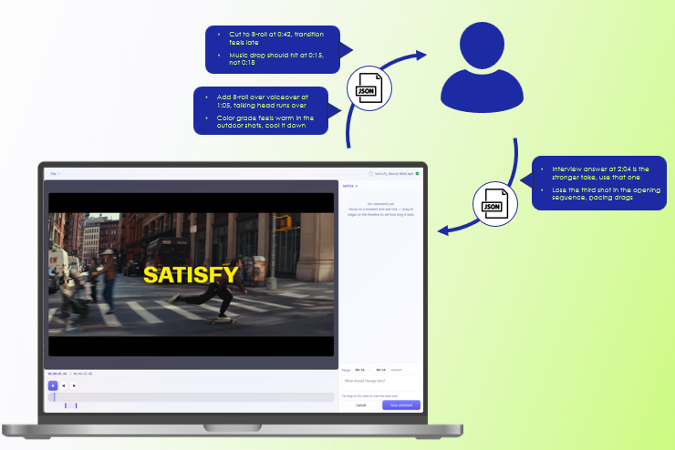
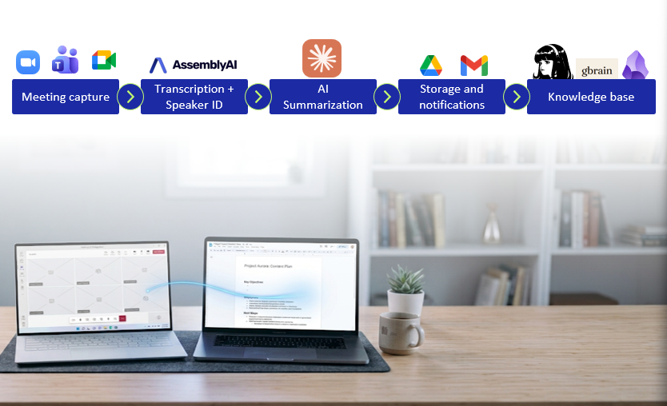
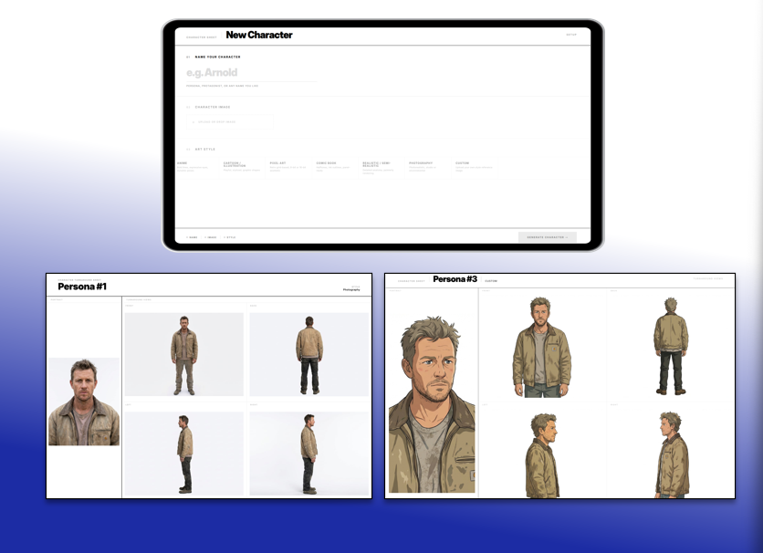
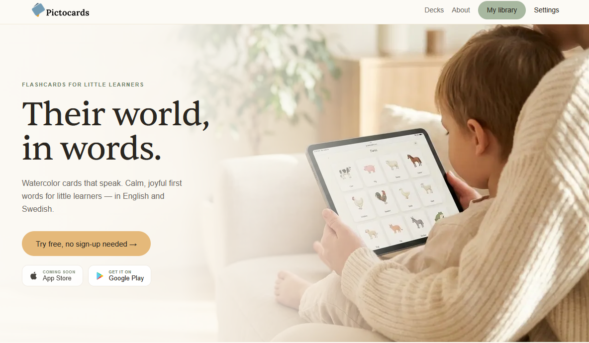
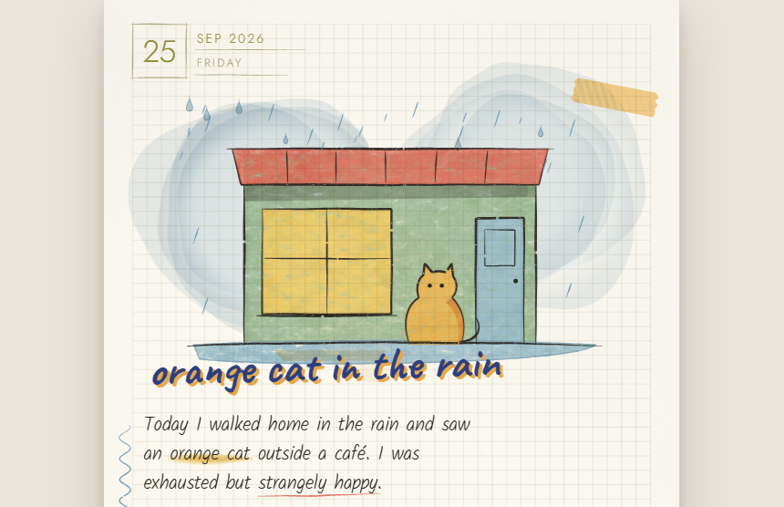
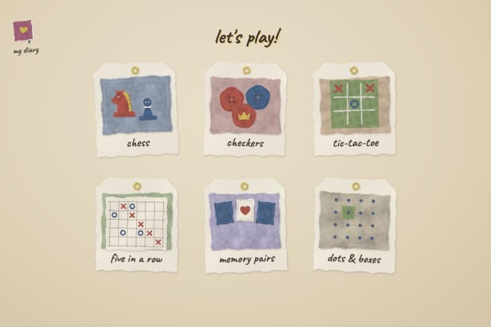
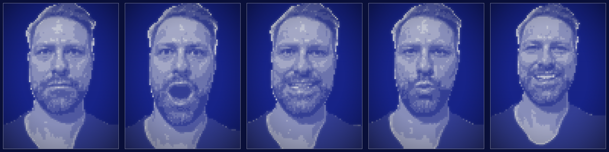

 

&nbsp;&nbsp;

 

 

## Builds

<table width="100%">
<tr>
<td width="50%" valign="top">
<h3>📹 Local Video Annotation Tool</h3>

Offline, single-file HTML tool for timestamped video feedback. No uploads, no accounts, no backend. Built after receiving feedback on the same video in six different formats in one week.

[→ GitHub](https://github.com/jbmathisen/LocalVideoAnnotation-tool)

</td>
<td width="50%" valign="top">
<h3>🎙️ Win Meeting Notes</h3>

Windows 11 meeting transcription that records, identifies speakers, and routes structured notes into Obsidian via Google Drive and Gmail. ~$0.026 per meeting.

[→ GitHub](https://github.com/jbmathisen/Win_MeetingNotes)

</td>
</tr>
<tr>
<td width="50%" valign="top">
<h3>🖼️ Stockholm Tech Portrait Agent</h3>

Upload a photo, pick a hex code. The agent reads the color's warmth, determines styling direction, and generates a photorealistic studio portrait. Stripe handles payment before anything runs.

*Link on request*

</td>
<td width="50%" valign="top">
<h3>🎨 Batch Creative Workflow</h3>

Takes a master prompt, a reference image, and a list of subjects, then generates a full visual set from a single config. Runs 10+ prompt variations across 10+ models before committing.

*Link on request*

</td>
</tr>
<tr>
<td width="50%" valign="top">
<h3>🕹️ Character Turnaround Agent</h3>

Generates a full turnaround sheet from one character image: front, back, left, right, portrait. Routes by art style, builds angle-specific prompts, runs identity checks between views. Avg <$0.70, ~3 min.

[→ Try it](https://app.mindstudio.ai/agents/character-turnaround-generator-v102-7e5ea0dd)

</td>
<td width="50%" valign="top">
<h3>🃏 Pictocards</h3>

Flashcard app for children learning first words. Deck-based model, one account across App Store, Google Play, and web. Built iteratively with Claude. Designed to eventually support children with ASD.

[→ pictocards.app](https://pictocards.app)

</td>
</tr>
<tr>
<td width="50%" valign="top">
<h3>✍️ AI Blog Generator</h3>

Post generator built into a Norwegian freelancer platform. Topic, audience, length, tone — brief to publish-ready in minutes. I handled agent design and workflow.

*Link on request*

</td>
<td width="50%" valign="top">
<h3>🗓️ School Dashboard</h3>

Calm, glanceable school dashboard on a wall screen for kids who need visual structure. Today's lessons, a merged packing list, test countdowns, and a get-ready clock that shifts green to red before school. The repo is written so an AI assistant can guide any parent through setup.

[→ GitHub](https://github.com/jbmathisen/opsve-skol-dashboard)

</td>
</tr>
<tr>
<td width="50%" valign="top">
<h3>📔 Visual Diary</h3>

A digital diary companion. Write a few lines about the day and it becomes an illustrated page that paints itself while you watch. The finished picture then becomes a small mini-game built from the day's story: jump in the puddles, flip the pancakes, fill the moat.

*Link on request*

</td>
<td width="50%" valign="top">
<h3>🎲 Felt Games Room</h3>

Six games inside the diary: chess, checkers, tic-tac-toe, five in a row, memory pairs, dots & boxes. Hand-cut felt look, Biscuit the dog as opponent, easy and tricky levels. Assets released free in crafterAssetLibrary.

*Link on request* · [→ Assets](https://github.com/jbmathisen/crafterAssetLibrary)

</td>
</tr>
<tr>
<td width="50%" valign="top">
<h3>📺 Talking Head</h3>

Voice-reactive pixel avatar for explanation videos. Five photos become a sprite set; the voice track drives mouth shapes and blinks, rendered as a codec-style overlay in brand blue. Alpha 1: works end to end, still rough at the edges.

*Link on request*

</td>
<td width="50%" valign="top">
<h3>✍️ Writing Companion</h3>

An adaptive writing companion, built through reactions rather than instructions. Claude plays options like a band; the writer listens like a producer and calls each line alive, stale or "not me". Every reaction is logged. When a pattern repeats, it's proposed as a rule in a personal voice profile, so each new text starts closer to how that person actually sounds. Anti-slop checks run last, once the material and angle are right.

*Link on request*

</td>
</tr>
<tr>
<td width="50%" valign="top">
<h3>🏃 Devsprinter</h3>

When several people and AI agents share a sprint, nobody can see who is working on what or how far along it is. The idea is to use the agent's own work plan as the signal. Each time the plan changes, a small progress update goes to GitHub, so ownership and honest progress show up where the team already works. Anyone not using it notices nothing.

*Work in progress*

</td>
<td width="50%" valign="top">
<h3>🛠️ Visual Tools</h3>

Four small browser tools for graphic work. AH.Grid does Hofmann-style string letterforms, Motif composes patterns, SVG Creator draws tile shapes, and Etchr runs photo effects.

[→ namepending.se/tools](https://namepending.se/tools/)

</td>
</tr>
</table>

 

## Background

15+ years across strategy, communication, and design. The through-line has been the same: take something complex and make it work.
Now building tools, both for fun and professionally (believe it or not).

 

---

Stockholm · namepending.se

